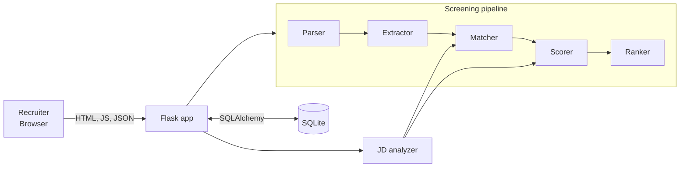

<div align="center">

# AI-Based Resume Screening and Candidate Ranking System

**Intelligent resume screening and candidate ranking, with scores you can explain.**


</div>

This project is a web application that compares resumes (PDF or DOCX) with a job description, gives every candidate a **0 to 100 match score**, and ranks candidates from best to lowest match. Each score comes with **matched and missing skills and a short explanation**, so a recruiter can see why a candidate ranked where they did. It is a decision-support tool: a person always makes the final decision.

## Features
- **Resume parsing** for PDF (PyMuPDF) and DOCX (python-docx), including tables; empty or scanned files give a clear error.
- **Information extraction**: name, email, phone, skills and resume sections (education, experience, projects, certifications).
- **Job description analysis**: required and preferred skills, minimum experience, education and certification needs.
- **Semantic matching** with Sentence Transformers (`all-MiniLM-L6-v2`) plus skill-alias rules (for example "ML" equals "machine learning").
- **Explainable five-factor score** with labels: Strong, Good, Partial, Weak.
- **Recruiter workflow**: search, skill filter, status filter, minimum-score slider, candidate status (`NEW`, `REVIEW`, `SHORTLISTED`, `REJECTED`), notes and **CSV export**.
- **Dashboard** with resumes screened, average score, shortlisted count and charts.
- **REST API** and a responsive UI with light, dark and system themes.

## How it works
1. The recruiter enters a job title and description. The system extracts required skills, experience and education.
2. The recruiter uploads resumes (PDF or DOCX).
3. Each resume is parsed to text, then name, contact details, skills and sections are extracted.
4. The resume is compared with the job: meaning similarity (embeddings) and skill matching.
5. Five factors are combined into one score with an explanation.
6. Candidates are ranked and labelled. The recruiter reviews, filters, sets a status and exports.

## System architecture



## Scoring model

```
Score = 100 x ( 0.45 x semantic + 0.25 x required skills + 0.15 x experience
              + 0.10 x education + 0.05 x certifications )
```

| Factor | Weight | Meaning |
|---|---|---|
| Semantic match | 45% | How close the resume and job text are in meaning (MiniLM cosine similarity) |
| Required skills | 25% | Share of required skills found |
| Experience | 15% | Resume years compared with years required (capped at 1) |
| Education | 10% | Highest degree level found |
| Certifications | 5% | Whether certifications are listed |

Labels: **Strong** >= 75, **Good** >= 55, **Partial** >= 35, otherwise **Weak**. Weights live in `config.py`.

## Tech stack
| Area | Technology |
|---|---|
| Backend | Python, Flask 3.0.3, Flask-SQLAlchemy 3.1.1 |
| Database | SQLite |
| Parsing | PyMuPDF, python-docx |
| NLP | spaCy (`en_core_web_sm`), regex, skill dictionary |
| Embeddings | Sentence Transformers, `all-MiniLM-L6-v2` |
| Frontend | HTML, CSS, JavaScript, Chart.js |

## Project structure
```
talentlens-ai/
|-- app.py            # Flask app: pages, REST API, CSV export, stats
|-- config.py         # weights, model names, upload rules
|-- database/         # db.py, models.py (Job, Candidate, ScreeningResult)
|-- modules/          # parser, extractor, jd_analyzer, matcher, scorer, ranker, pipeline
|-- templates/        # 5 Jinja pages
|-- static/           # css, js
|-- data/sample_resumes/
|-- tests/            # empty placeholder; automated tests planned
`-- requirements.txt
```

## Getting started

Prerequisites: Python 3.10+, internet on first run (the MiniLM model is downloaded once).

```bash
git clone https://github.com/rajjaiswal2057-ui/talentlens-ai.git
cd talentlens-ai

python -m venv venv
# Windows:  venv\Scripts\activate
# macOS/Linux:  source venv/bin/activate

pip install -r requirements.txt
python -m spacy download en_core_web_sm
python app.py
```
Open **http://127.0.0.1:5000**.

## Usage
1. Open **Screening**, enter a job title and description, and analyse it.
2. Upload resumes (PDF or DOCX) and press **Screen resumes**.
3. Open the ranking page: search, filter by skill, status or minimum score.
4. Open a candidate to see the score breakdown and explanation.
5. Set a status, add notes, and use **Export CSV**.
6. Use the **Dashboard** for an overview.

## Security and privacy
- Uploads are stored outside `static/` with sanitised names; only PDF and DOCX are accepted.
- Resumes are processed locally; the embedding model runs offline after the first download.
- This prototype has **no authentication**. Add it before deploying for multiple users.
- Do not commit real resumes. Use sample or approved data only.

## Responsible AI
This system supports, and does not replace, human judgement. Scoring uses job-related signals only (skills, experience, education, certifications, semantic fit); it does not use name, gender, age or photo. The score shows how closely a resume matches a job description, not whether a person is suitable. Results should be reviewed by a person.

## Limitations
- Skills come from a fixed dictionary of about 50 skills; very short names such as "c" or "go" can match wrongly.
- "B.Sc" written with a dot is not recognised as a degree.
- Overlapping jobs can be double counted in experience.
- Long resumes are truncated by the embedding model (about 256 word pieces).
- Scanned PDFs are rejected (no OCR).
- Weights were set by judgement and not tuned on labelled data. **Ranking accuracy has not been measured**; no accuracy figure is claimed.
- Validation so far is manual testing on 10 sample resumes. Automated tests are not included yet.

## Roadmap
- [ ] Automated tests (parser, extractor, scorer, API)
- [ ] Evaluation against recruiter rankings
- [ ] Larger skill taxonomy and context-aware short-skill matching
- [ ] Date-interval merging for experience; degree normalisation
- [ ] Chunking for long resumes; OCR for scanned PDFs
- [ ] Fairness audit and authentication

## Author
Raj Jaiswal

## References
1. N. Reimers and I. Gurevych, "Sentence-BERT," in *Proc. EMNLP-IJCNLP*, 2019.
2. W. Wang et al., "MiniLM: Deep self-attention distillation," in *Proc. NeurIPS*, 2020.
3. M. Honnibal et al., "spaCy: Industrial-strength NLP in Python," Zenodo, 2020.
4. Flask, PyMuPDF and python-docx documentation.

## License
Released under the [MIT License](LICENSE).
